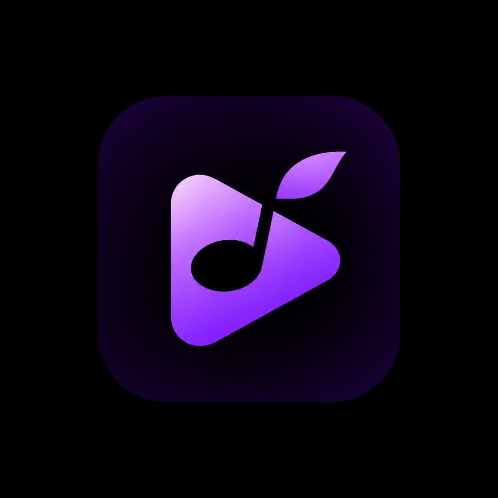

  
  <h1>XION Player</h1>
  
Next-gen Electron desktop music player for Windows with real-time synced lyrics, 15 customizable themes, Discord Rich Presence, playlist management, and built-in auto-updates.

---

## Features

- **Real-Time Synced Lyrics** — High-precision karaoke-style lyrics sync with click-to-seek
- **15 Built-In Themes** — Cyberpunk Neon, Midnight Velvet, Live Aurora, Starry Space, Retro Grid, Glowify Liquid, and more
- **Discord Rich Presence** — Displays your currently playing track live on Discord
- **Playlists & Library** — Create, edit, import, and manage Liked Songs and custom playlists locally
- **Now Playing Sidebar** — Quick Like, Lyrics, Queue, Fullscreen, and Copy Song Info controls
- **System Tray & Media Controls** — Minimize to tray with full playback controls
- **Automatic Updates** — Background update checks, progress tracking, and one-click install via **Settings → System & Updates**

## Download & Install

1. Go to the [Latest Release](https://github.com/nxion07/xion-player/releases/latest).
2. Download and run `XION-Player-Setup-x.x.x.exe`.
3. Future updates will be detected and installed automatically inside the app.
